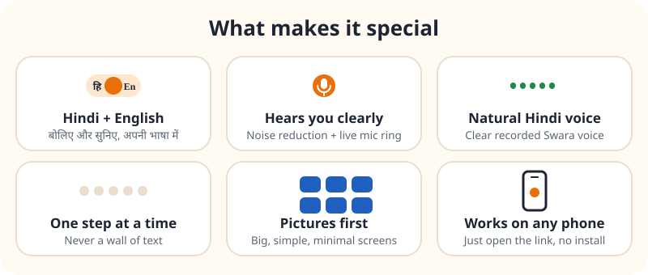

<p align="center"></p>

# Sahayak (सहायक)

**A voice assistant that helps people finish government tasks, in their own language.**
Many people in India can read little English and find government websites confusing. Sahayak lets them *speak in Hindi* and *listen in Hindi*, one simple step at a time.

**Live site:** https://rohanjaswara88-art.github.io/sahayak-ai-assistant/

## How it works

<p align="center"></p>

1. **Speak** – tap the big mic and say what you need, like "आधार कार्ड बनवाना है", or just tap a picture.
2. **Understand** – it matches Hindi, English and Hinglish words to the right guide.
3. **Guide** – it shows one short step at a time with a big icon. Say "अगला" (next), "पीछे" (back) or "दोबारा" (repeat), or tap the buttons.
4. **Hear** – every step is read aloud in a clear Hindi voice.

## What makes it special

<p align="center"></p>

- **Hindi + English:** switch language with a tap, or say "English" or "हिंदी".
- **Hears you clearly:** noise reduction and a live mic ring show that it is listening. It tells you out loud if it could not hear you.
- **Natural Hindi voice:** every line is a recorded clip, so it sounds the same on any phone, even one with no Hindi voice installed.
- **One step at a time:** no walls of text.
- **Pictures first:** big, simple, minimal screens.
- **No install:** open the link on any phone. Voice listening works in Chrome and Edge.

## Guides included

Aadhaar card, PAN card, ration card, voter ID, driving licence, Ayushman card, passport, birth certificate.

## Run it on your computer

```bash
python -m http.server 8080
```

Then open `http://localhost:8080` in Chrome or Edge.

## Add or change a guide

1. Edit `data.js` (the guides) or `strings.js` (the messages).
2. Run `node build-audio.js` to record the new voice clips (needs `pip install edge-tts` and internet).
3. Commit and push. The site updates on its own.

*The steps are general guidance. Always check the official website for the latest rules and fees.*
